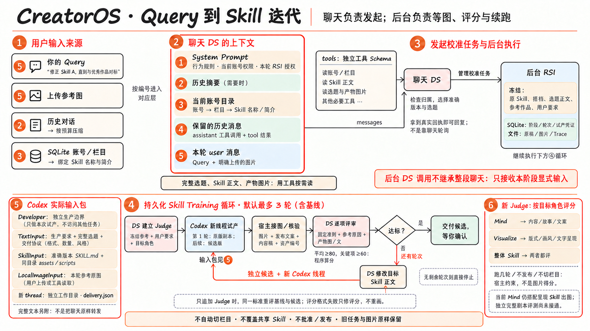

# 从一句 Query 到 Skill 迭代：当前真实链路

代码核对日期：2026-10-22。图中的新 Judge 策略只用于本次修改后新建的任务；旧任务不迁移、不重评。本文区分聊天上下文、持久任务状态和 Codex 的生产上下文，不把它们称作同一个 session。

## 先用一句人话概括

你对账号助手说“修正 Skill A，直到与优秀作品对标”。账号助手找到正确的 Skill、选题和参考作品，交给一张**能持久保存的工作单**。随后后台自己负责：让 Codex 试做 → 让 DS 看结果 → 改一份候选 → 再试做。聊天结束不等于工作单结束。

这不是训练 DS 或 Codex 的模型权重，而是根据证据迭代 Skill 正文。默认最多三轮，第一轮就是原版副本的基线；达到本版 Judge 门槛或轮次用完就停。合格也只是交候选，不能代替你的最终审美判断。



## 1. 我的 Query 到底放在哪？

放在最后一条 `role=user` 消息中，按原话保存。**不是 System Prompt，也不会自动变成共享 Skill 的规则。** 上传图片时，同一条 user 消息保存文字和图片引用；真正请求模型时才解析成图片输入。

一次聊天模型请求的大致顺序如下。它们仍是一份有序消息列表，不是六个独立数据库。

```text
messages = [
  system：固定行为规则 + 当前账号权限 + 本轮RSI授权（如有），
  user：历史压缩摘要（如果压缩过），
  user：宿主提供的当前账号目录（标明它是数据，不是命令），
  ...保留的近期聊天、assistant工具调用、tool结果，
  user：你这次的原始Query + 图片引用，
  ...本轮后来新增的assistant调用、tool结果、明确读取的图片
]
tools = 本账号允许使用的工具JSON Schema  # 单独的API字段
```

第一次模型调用还没有本轮新增的工具结果。DS 决定调用工具后，宿主检查归属、执行工具，把结果追加进去，再请求 DS；这就是工具循环。原始结果完整保存，下一次给模型的结果可以只投影必要业务字段。工具结果里的“这是一个图片文件路径”并不等于模型已经看到了像素。

源码：[追加用户消息与组装请求](../../../creatoros/agent/loop.py)，[Web 会话入口](../../../creatoros/web/chat.py)，[工具结果投影](../../../creatoros/tools/model_projection.py)。

## 2. 默认账号目录有多少东西？

| 默认给聊天 DS 的数据 | 不默认塞进来的数据 |
|---|---|
| 当前账号名称、平台、账号标识、时区、启用状态等 | 其他账号资料 |
| 当前账号全部栏目的名称、启用状态、版本号及 Skill 绑定 | 整个选题列表、全部选题正文 |
| 去重后的绑定 Skill 名称、中文显示名、description、可用状态 | Skill 正文和 assets 的实际像素 |
| 查询时间、字段截短说明；内部 ID 供工具定位 | 所有历史产物、点赞收藏等动态反馈 |

完整 Skill、选题、作品和反馈要通过工具读取。看图片还需要受管图片读取，不能只看文件名。账号目录每次用户请求重建，特定写操作后刷新；不是所有外部变化都会在同一轮聊天中实时同步。

Web 工具按账号白名单暴露，并在执行时再次检查资源归属。它不是“给模型 bash，允许随意查全库”，也不是每个 Query 自动检索一小批工具。目前动态能力主要是**作用域裁剪 + 按需读取资料**，不要夸大成完整工具检索系统。

源码：[账号目录](../../../creatoros/web/account_context.py)，[工具权限参数](../../../creatoros/tools/host_contract.py)。

## 3. 太长了如何压缩？原话还在吗？

完整消息账本留在本会话的 `messages.json`，压缩只改变下一次请求的视图，不把原话删掉。

模型窗口目前由项目配置为 1M，输出预留 32,768，输入预算为 967,232。达到估算输入预算的 90% 左右尝试压缩；这是一种粗估，不是精确 tokenizer。通常保留近期完整用户轮次，最新一轮太长才按完整模型 Step 切开，并保留这轮原始 Query。

旧历史被滚动更新为**一份累计摘要**，不是不断堆新摘要。超长工具结果可归档，模型能用当前会话的回读工具取原文。历史图片也有传输预算；没继续载入像素时会注明“历史图片本次未载入”，不能把摘要里的描述等同还在看原图。压缩无效或仍超硬预算时停止请求，不静默丢掉用户要求。

这不等于已经实现了“长期用户记忆自动提取”。目前长期事实主要在业务 SQLite、版本化 Skill 和代码里的硬规则；跨会话偏好自动总结、审查、合并、召回没有单独建好。

源码：[预算](../../../creatoros/ai/context.py)，[压缩计划](../../../creatoros/agent/compaction.py)，[摘要与原文保留](../../../creatoros/agent/compactor.py)，[请求视图](../../../creatoros/session/checkpoint.py)。

## 4. 为什么聊天结束了，RSI 还能继续？

因为后台工作单不是聊天的下一个模型 Step。

账号 DS 用 `manage_skill_iteration(start)` 选择当前账号的栏目、准确 Skill 版本、已存在的选题和参考图，附上明确的校准要求。宿主固定会话与请求身份、核对归属和重复提交；SQLite `skill_iterations.config_json` 冻结原 Skill 摘要、搭档、标题和 brief、要求、参考池，`state_json` 保存阶段、轮次、试产凭证、Judge 和分数。图像和模型原始响应存任务目录。

**“直到对标优秀作品”本身不够完整。** 工具还需要确定哪个 Skill、哪条试产选题、哪些参考作品。账号 DS 可以通过工具补齐；不知道目标时应问你，不应凭空猜。聊天里的重要约束必须明确写入创建工作单的参数；后台不会自动继承整个聊天。

后台线程持续推进工作单，等 Codex 时只查实际试产状态，不反复调用 DS。它启动一次试产后记下稳定凭证，刷新和重复查询不能再开一次生产。聊天最多 30 个模型 Step，与 RSI 默认三轮试产是两种完全不同的限制。

源码：[对象级任务工具](../../../creatoros/tools/skill_iterations.py)，[持久化与阶段推进](../../../creatoros/integrations/skill_iterations.py)，[表定义](../../../creatoros/storage/models.py)。

## 5. 后台 DS 每次真正拿到什么？

这是**新的独立模型请求**：自己的 system + 显式 JSON 数据 + 需要的参考/产物像素，没有账号聊天完整历史，也没有聊天工具列表。

| 阶段 | 文字输入 | 图像输入 | 输出 |
|---|---|---|---|
| 建 Judge | 用户明确要求、选题标题、Skill 角色；新任务另带选题 brief 和评分范围策略 | 本任务冻结的优秀参考 | 可检查的准则、参考依据、关键项 |
| 评分 | 固定准则、要求、选题标题、产出标题和发布正文；新任务另带 brief、角色范围 | 冻结优秀参考 + 本轮实际产图 | 逐条分数与证据、差异、允许时的新准则 |
| 改候选 | 完整目标 SKILL.md、文件列表、Judge、分数和反馈、要求、标题；新任务另带 brief、角色范围 | 冻结参考 + 最佳轮产图 | 完整候选正文与改动说明 |

注意：目前建标还没有自动读入完整 Skill 正文；本轮新策略已补入冻结选题 brief，旧任务请求原样兼容。评分的 `production_text` 目前只是发布标题＋正文，不是完整剧本。原 Skill 的正文在改候选阶段才明确进入 DS 的输入。不要把图理解成每一步模型都自动知道整张工作单的所有字段。

自动改稿目前只改目标 Skill 正文，不改冻结搭档、assets 或 scripts。它可以在规则里引用已有优秀参考，但没有建设一个跨任务的全局优秀作品库。

新 Judge 将评分范围按角色收窄：Mind 看内容、故事与文案；Visualize 看版式、画风、文字呈现；整体 Skill 看两者。流程要求如“不发布、不切栏目、最多三轮”由宿主控制，不是作品画面得分。范围类型由程序校验，具体审美判断仍由模型完成，不能保证模型永不误判。

当前 Mind 仍搭配栏目呈现 Skill 走图文试产，不是只生成完整剧本。**独立剧本/分镜交付与只对剧本评测，还需要下一步接通；本轮不假装已经实现。**

源码：[独立 DS 调用与严格回复](../../../creatoros/integrations/skill_iteration_judge.py)，[当前试产素材收集](../../../creatoros/integrations/skill_iterations.py)，[角色与搭档限制](../../../creatoros/integrations/skill_version_service.py)。

## 6. Codex 真正收到的不是整段 DS 聊天

把它理解成生产工人拿到的一包准确材料：

1. **Developer 指令**：只做本次独立生产，不读其他任务、全局记忆或项目开发资料。
2. **TextInput**：本次制作说明、冻结选题正文、当前工作目录、参考规则、交付索引约定。
3. **SkillInput**：准确版本 SKILL.md 路径；同目录正文、assets、scripts 是该版本冻结的原件。
4. **LocalImageInput**：本轮明确提供的参考原图，实际交给 SDK，不是只给文件名。
5. **线程设置**：独立工作目录、workspace_write、deny_all；每轮新线程。技术恢复才使用同一轮的准确旧 thread。

一般生产时，Skill 的全部 assets 不会自动逐张变成图片输入；Codex 能读文件，提示词要求实际打开相关参考并交给生图工具。RSI 选中的优秀参考则额外通过 `LocalImageInput` 明确交付。能访问文件不等于已经阅读，真正读没读要看公开执行 Trace。

这次提供的是之前真实隔离任务的完整发送样本，不是新生产，不包含正式账号内容：

- [完整生产 TextInput 原文](codex-production-prompt.txt)：未删节，复制自真实落盘的 `production_instructions.txt`。
- [Developer 原文、SDK 设置及输入包说明](codex-input-envelope.md)：补齐不在 TextInput 里的东西。

不能把这些称为 Codex 服务内部完整 System Prompt；我们能准确展示的是 **CreatorOS 发送的全部显式生产输入及配置**。Codex 如何注入其服务内部系统规则，不由 CreatorOS 管理。

这个实际样本也如实保留了当前一处冗余：工作台把“标题＋brief＋本次要求”同时放进 title 和 brief，并不是已经完全简化的协议。本轮没有趁重启改生产协议或重写旧样本。

源码：[Prompt 组装和实际 SDK 调用](../../../creatoros/integrations/native_production.py)，[生产设置](../../../creatoros/integrations/codex.py)，[参考原图交接](../../../creatoros/integrations/topic_references.py)。

## 7. 一轮结束以后，谁决定下一步？

Codex 按 Skill 完成内容稿和图片，更新 `delivery.json`，声明实际采用的资产编号、图片 Prompt、引用素材和内容稿文件。CreatorOS 接收真实图片、核验文件和哈希，保存生产凭证。这种文件检查不是美学判断。

DS 再按固定 Judge 逐项评分。程序算平均分：至少 80，关键项至少 60，才判为本版标准通过。模型不能自行降门槛。允许追加准则时，原项不能删除或放宽；追加后以同一标准重评基线和所有候选，历次评分仍留档。

不合格且还有轮次：DS 根据具体证据改目标正文，生成独立候选，下一轮 Codex 新线程试产。合格：交付候选。用完轮次：停止并保留最佳候选和失败记录。Judge JSON 不合法最多仅修评分一次，不为修 JSON 重生图；修复仍失败，显式恢复当前评审阶段。

RSI 不自动改栏目绑定、不批准、不发布；已经存在的任务不会在服务重启时因为本次修复被自动重评或重新生图。最终采用哪个版本由你确认。

## 一句话记住三个“上下文”

**聊天上下文**回答“你和我说过什么、当前账号有哪些东西”；**RSI 工作单**记录“这次究竟改哪版、用哪条选题和参考、目前到哪一步”；**Codex 上下文**只负责“拿这份准确 Skill 和选题，把这一轮作品做出来”。三者通过明确参数和真实回执衔接，不靠隐含共享记忆。

## 图与证据

- 图片由内置生图工具生成，对照代码核查标签和连线；实际1672×941，不把提示词请求的4K目标冒充输出分辨率。左侧编号对应上下文层，橙色回路表示候选改稿后再次试产。
- [绘图提示词](diagram-prompt.txt)、[定向修图提示词](diagram-refinement-prompts.txt)与[统一风格](global_style.md)保留。图只概括输入包，完整生产文本在独立文件中。
- 正式部署的备份、空闲核查与不变性结果保存在本地忽略目录 `tmp/restart-rsi-policy-20261022/`，不上传业务库、原任务图片或凭证。
